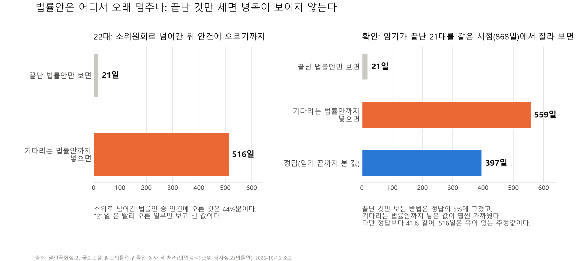
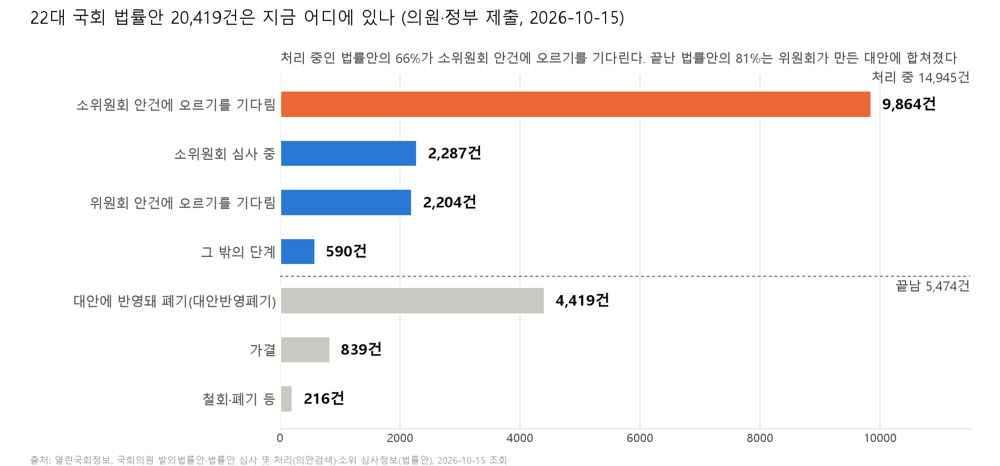
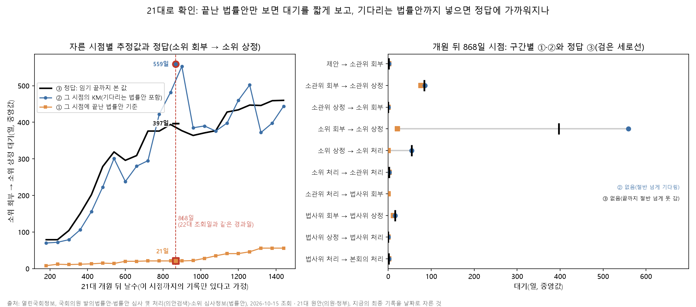
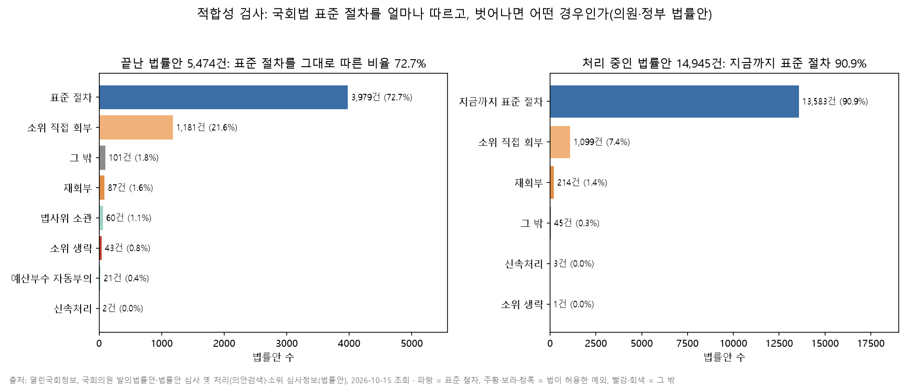
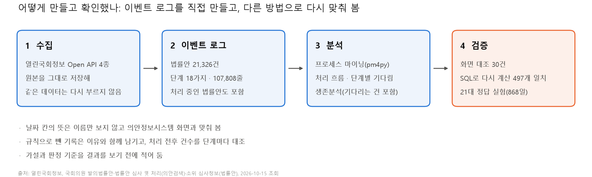

# 국회 법률안은 어디서 멈추나: 프로세스 마이닝

국회에 낸 법률안이 어느 단계에서 얼마나 오래 기다리는지 데이터로 확인한 개인 프로젝트입니다. 국회가 공개하는 데이터(열린국회정보 Open API)에서 법률안마다 "어떤 단계를 언제 거쳤는지"를 모아 **이벤트 로그를 직접 만들고**, 프로세스 마이닝으로 처리 흐름과 기다리는 시간을 분석했습니다.

> **프로세스 마이닝이란?** 택배 조회 화면을 떠올리면 쉽습니다. "접수 → 집하 → 배송 출발 → 도착"처럼 물건마다 단계와 시각이 찍힌 기록이 있으면, 수만 건을 모아 "어디서 가장 오래 머무는지", "정해진 순서대로 가는지"를 볼 수 있습니다. 이 기록표를 **이벤트 로그**라고 부릅니다. 국회 법률안에는 이런 표가 따로 없어서, 공개 데이터의 날짜 칸들을 모아 직접 만들었습니다.

## 왜 시작했나

법률안 소식은 대개 "발의됐다"와 "통과됐다" 두 번만 들립니다. 그 사이에 무슨 일이 일어나는지는 잘 보이지 않습니다. 그런데 임기가 끝난 21대 국회의 기록을 보면, 의원과 정부가 낸 법률안 24,486건 가운데 **66.9%가 처리되지 못한 채 임기만료로 폐기**됐습니다. 그대로 통과된 것은 6.6%, 위원회가 만든 대안에 내용이 반영된 것이 24.3%였습니다. 대부분의 법률안이 끝을 보지 못한다면, 그 법률안들은 어디에 멈춰 있었을까가 궁금했습니다.

두 번째로 궁금했던 것은 방법입니다. 프로세스 마이닝은 보통 기업 시스템에 이미 쌓인 이벤트 로그로 시작합니다. 현실의 많은 기록은 그렇게 정리돼 있지 않고, 여러 곳에 흩어진 날짜 칸으로 남아 있습니다. 공공 데이터처럼 흩어진 기록으로도 믿을 수 있는 이벤트 로그를 만들 수 있는지, 만든다면 어디서 틀리기 쉬운지 직접 해 보고 싶었습니다.

### 궁금했던 것

1. 법률안은 처리 과정의 **어느 단계에서 가장 오래 기다리나**
2. 아직 처리 중인 법률안이 70%나 되는데, **끝나지 않은 건을 어떻게 세야** 기다리는 시간을 바르게 볼 수 있나
3. 실제 처리 과정은 **국회법이 정한 절차를 얼마나 따르나**
4. 위원회는 법률안을 **한 건씩 다루나, 묶어서 다루나**
5. 흩어진 공공 기록으로 만든 이벤트 로그를 **어떻게 검증하나**

질문마다 결과를 보기 전에 가설과 판정 기준을 적어 두고 확인했습니다(아래 "가설과 판정 전체 보기").



## 한눈에

| | |
|---|---|
| 대상 | 22대 국회 법률안 **21,326건**(제안일 2024-05-30～2026-10-14). 처리 중인 법률안 14,956건(70%)도 포함 |
| 가장 오래 멈추는 곳 | 위원회 안의 작은 모임(**소위원회**)에서 **심사가 시작되기 전**. 끝난 법률안만 보면 21일이지만, 아직 기다리는 법률안까지 넣으면 **516일** |
| 지금 기다리는 법률안 | 처리 중인 법률안의 **66%**(9,864건)가 이 단계에 있음 |
| 끝난 법률안은 | **81%**가 위원회가 여러 법률안을 합쳐 만든 새 안(대안)에 반영된 채 폐기됨 |
| 방법이 맞는지 | 임기가 끝나 결말을 아는 21대 국회로 같은 계산을 해 봄. 끝난 것만 보는 방법은 정답의 5%, 기다리는 법률안까지 넣은 방법이 훨씬 가까움 |
| 검증 | 날짜 칸의 뜻을 의안정보시스템 화면 **30건**과 대조. 핵심 수치 **497개**를 다른 도구(SQL)로 처음부터 다시 계산해 모두 일치 |
| 1쪽 보고서 | [outputs/report.md](outputs/report.md) |

## 법률안이 지나는 길

법률안은 대략 이 순서로 처리됩니다.

1. **제안**: 의원이나 정부가 법률안을 냄
2. **소관위 회부**: 그 분야를 맡은 위원회(**소관위**, 예: 보건복지위원회)에 심사를 맡김
3. **소관위 상정**: 위원회 회의 안건으로 올려 다루기 시작함(**상정**)
4. **소위 회부 → 소위 상정 → 소위 처리**: 위원회 안의 작은 모임(**소위**)이 조문을 하나씩 심사함. 실제 심사는 대부분 여기서 일어남
5. **소관위 처리**: 위원회가 결론을 냄. 비슷한 법률안 여러 건을 합쳐 새 안(**대안**)을 만들면, 원래 법률안은 내용이 대안에 반영된 채 폐기됨(**대안반영폐기**)
6. **법사위 검토 → 본회의**: 법제사법위원회가 법률 문구를 검토한 뒤 본회의에서 의결

더 많은 용어는 [용어 정리](docs/용어.md)에 있습니다.

## 결과

### 1. 끝난 법률안만 보면 병목을 놓친다

소위로 넘어간 법률안 17,629건 중 실제로 소위 안건에 오른 것은 44%뿐입니다. 끝난 법률안만 보면 "안건에 오르기까지 21일"이지만, 이 값은 빨리 오른 법률안만 보고 낸 것입니다. 은행 창구에서 이미 업무를 마친 사람만 보고 "대기시간 5분"이라고 하면, 아직 줄을 서 있는 사람들의 기다림이 빠지는 것과 같습니다.

아직 기다리는 법률안까지 넣어 계산하는 방법(**생존분석**)을 쓰면, 소위로 넘어간 법률안의 절반이 안건에 오르기까지 **516일**이 걸립니다. 처리 단계 가운데 가장 깁니다. 반면 법제사법위원회의 문구 검토는 16일로 병목이 아니었습니다.



### 2. 이 방법이 맞는지, 결말을 아는 21대로 확인했다

22대는 아직 진행 중이라 "516일"이 맞는지 알 수 없습니다. 그래서 임기가 끝난 21대 국회를 22대와 같은 시점(개원 뒤 868일)까지의 기록만 있는 것처럼 잘라 같은 계산을 하고, 임기 끝까지 본 값(정답 397일)과 비교했습니다.

- 끝난 법률안만 보는 방법: **21일**. 정답의 5%로 크게 짧았습니다
- 기다리는 법률안까지 넣는 방법: **559일**. 정답보다 41% 길었지만 훨씬 가까웠습니다
- 자르는 시점을 22가지로 바꿔 봐도 앞의 방법은 정답의 4～15%, 뒤의 방법은 71～147%였습니다

즉 **방향은 확실히 맞지만 정확한 날수에는 폭이 있습니다.** 22대의 516일도 그 정도 폭이 있는 추정값으로 읽어야 합니다.



### 3. 법률안은 한 건씩이 아니라 묶음으로 처리된다

- 위원회에서 처리된 법률안의 99.7%는 같은 날 다른 법률안과 함께 처리됐습니다(한 회의에서 보통 42건)
- 소위에 상정된 법률안의 81.3%는 같은 날 **같은 법을 고치는 다른 법률안**과 함께 상정됐습니다. 소위는 법률안을 법 단위로 묶어서 다룹니다
- 대안 1건은 법률안을 보통 3건, 많게는 246건 흡수했습니다
- 대안반영폐기된 법률안은 위원회 처리부터 대안의 본회의 통과까지 21일을 더 기다렸고, 그중 13일이 대안의 법사위 검토였습니다


### 4. 표준 절차를 얼마나 따르나

국회법이 정한 표준 절차를 모델로 정하고, 실제 법률안이 지나간 길과 맞춰 봤습니다(**적합성 검사**).

- 끝난 법률안의 **72.7%**가 표준 절차를 그대로 따랐습니다
- 벗어난 경우의 **90.4%**는 법이 허용한 예외였습니다. 가장 많은 것은 위원회 전체회의를 거치지 않고 소위에 바로 넘기는 **소위 직접 회부**(끝난 법률안의 21.6%)로, 사실상 두 번째 정상 경로입니다
- 나머지 대부분은 소위 기록 일부가 빠진 패턴이었습니다. 적합성 검사가 데이터 품질 점검에도 쓰인다는 것을 확인했습니다



### 5. 더 들여다본 것

- **소위는 절반을 두 번 이상 심사한다.** 위원회 회의별 기록을 법률안마다 따로 받아 세 보니, 소위에 상정된 법률안의 49.1%가 두 번 이상 상정됐습니다(최대 13번). 다시 상정되는 간격은 절반이 7일 안이라, 대부분 같은 회기 안에서 이어지는 연속 심사입니다
- **법률안 단위로 세면 회의가 수십 배로 부풀려진다.** 회의 한 번에 법률안 수십 건을 함께 다루기 때문에, 법률안마다 기록하면 회의 한 번이 수십 번의 사건이 됩니다. 사건 하나를 여러 법률안·대안·법·회의에 함께 연결하는 방식(**객체 중심 이벤트 로그, OCEL**)으로 다시 만들면 사건이 107,808개에서 63,064개로 줄고, 회의 활동은 법률안 단위로 셀 때 실제 회의 수의 15～46배였습니다
- **자동으로 찾은 모델과 규정 모델.** 데이터에서 자동으로 찾은 절차 모델은 기록을 더 잘 설명하지만(적합도 0.978 대 0.941), 기록에 없는 경로도 더 많이 허용했습니다(정밀도 0.661 대 0.831)
- **회부가 30일 넘게 걸린 164건은 대부분 이유가 있었다.** 의안정보시스템 화면으로 모두 확인하니 54건은 처음에는 1～3일 만에 다른 위원회에 회부됐다가 옮겨진 경우였고(API에는 마지막 회부만 남음), 실제로 늦게 회부된 111건 중 106건은 후반기 위원회가 구성되기 전에 제안된 법률안이었습니다

## 어떻게 믿을 수 있나



- **날짜 칸의 뜻을 화면과 대조**: API의 칸 이름만 보고 쓰지 않았습니다. 예를 들어 철회된 법률안의 "소관위 처리일"은 위원회 처리일이 아니라 철회일이 복사된 칸이었습니다. 의안정보시스템 화면과 맞춰 본 것이 30건(22대 27 · 21대 3)입니다
- **처리 전후 건수 대조**: 규칙에 따라 뺀 기록은 이유와 함께 따로 남기고, 단계마다 "원본 − 뺀 것 − 합친 것 = 로그"가 맞는지 코드가 확인합니다
- **다른 도구로 다시 계산**: 같은 코드를 다시 돌리는 것은 검증이 아니라서, 핵심 수치 497개를 SQL(DuckDB)로 처음부터 따로 계산해 모두 맞췄습니다. 첫 실행에서 분석 코드의 버그 1건을 이렇게 찾았습니다
- **결과를 보기 전에 기준을 적음**: 가설마다 "어떤 결과가 나오면 맞다고 볼지"를 먼저 적고 확인했습니다. 그래서 맞지 않은 가설도 그대로 남겼습니다(아래 표)

<details>
<summary>가설과 판정 전체 보기 (23개)</summary>

| | 가설·질문 | 결과 |
|---|---|---|
| H1 | 가장 오래 기다리는 곳은 소위 안건 상정 전이다 | **방법에 따라 갈림**: 처음 정한 판정 방식(끝난 법률안 기준)으로는 21일로 3위라 "맞지 않음". 미리 정해 둔 보완 방식(기다리는 법률안까지 포함)으로는 516일로 1위 |
| H2 | 위원회는 법률안을 묶어서 처리한다 | 맞음: 소관위 처리의 99.7%가 다른 법률안과 같은 날 함께 처리 |
| H3 | 처리 중인 법률안은 대부분 소위 안건 상정 전에 머문다 | 맞음: 66% |
| H4 | 법사위의 법률 문구 검토(체계·자구 심사)는 병목이 아니다 | 맞음: 넘어간 뒤 처리까지 16일 |
| H5 | 위원회마다 기다리는 기간이 크게 다르다 | 맞음: 기다리는 법률안까지 포함한 중앙값이 8일～635일 |
| H6 | 처리는 특정 시기에 몰린다 | 맞지 않음: 가장 많은 3개월이 28%(기준 30%) |
| Q7 | 의원안과 정부안은 다른가 | 소위 안건 상정까지 정부안 202일, 의원안 531일(기다리는 법률안까지 포함한 중앙값) |
| Q8 | 대안 1건은 법률안을 몇 건 흡수하나 | 보통 3건, 많게는 246건 |
| Q9 | 대안반영폐기 뒤의 기다림은 어디서 생기나 | 위원회 처리부터 대안의 본회의 통과까지 21일 중 13일이 대안의 법사위 검토 |
| C1 | 끝난 법률안의 대부분은 국회법 표준 절차를 그대로 따른다 | 맞지 않음: 72.7%(기준 90%). 법이 허용한 소위 직접 회부가 21.6%로 두 번째 주요 경로 |
| C2 | 표준 절차에서 벗어난 경우의 대부분은 법이 허용한 예외다 | 맞음: 90.4%(기준 80%) |
| T1 | (21대) 끝난 법률안만 보면 대기를 크게 짧게 본다 | 맞음: 소위 회부 → 상정 21일, 정답 397일 |
| T2 | (21대) 이 구간에서 기다리는 법률안까지 포함한 값이 정답에 더 가깝다 | 맞음: 559일(정답보다 41% 김), 끝난 법률안 기준은 95% 짧음 |
| T3 | (21대) 이 관계가 10개 구간 중 6개 이상에서 성립한다 | 맞지 않음: 5개. 나머지 5개는 두 값이 정답과 똑같아 차이가 없었고, 더 멀었던 구간은 없음 |
| D1 | 같은 법을 고치는 다른 법률안이 없는 법률안은 소위 상정까지 더 오래 기다린다 | 맞지 않음: 전체로는 맞지만 위원회 안 비교 13개 중 6개. 뚜렷한 차이는 같은 법 법률안이 50건 이상인 경우뿐 |
| D2 | 제정법안은 일부개정법안보다 오래 기다린다 | 맞지 않음: 오히려 제정 378일 대 일부개정 567일 |
| D3 | 정부안은 같은 위원회 안에서도 의원안보다 빨리 상정된다 | 맞음(근소): 위원회 7개 중 4개 |
| R1 | 소위는 같은 법률안을 여러 번 심사하는 일이 흔하다 | 맞음: 소위에 상정된 법률안의 49.1%가 두 번 이상 상정(기준 20%) |
| R2 | 다시 심사할 때는 한참 뒤에 이어진다 | 맞지 않음: 첫 상정 → 두 번째 상정 중앙값 7일(기준 90일) |
| R3 | 같은 법 법률안이 아주 많이 몰린 법률안이 더 자주 반복 심사된다 | 맞음: 50건 이상 65.5% 대 혼자 54.3%. 다만 중간 집단(33～38%)이 더 낮아 단조롭지 않음 |
| O1 | 그날 소위에서 기다리던 같은 법 법률안은 빠짐없이 함께 상정된다 | 맞지 않음: 17.7%(기준 70%). 함께 다루긴 하지만 일부만 골라 상정 |
| O2 | 대안은 오랜 기간에 걸쳐 들어온 법률안을 모은다 | 맞지 않음: 흡수한 법률안들의 회부일 범위 중앙값 118일(기준 180일) |
| I1 | 데이터로 자동으로 찾은 모델은 국회법 모델보다 기록에 더 잘 맞지만 덜 엄격하다 | 맞음: 적합도 0.978 대 0.941, 정밀도 0.661 대 0.831 |

가설의 배경과 판정 기준: H1～H6 [1015_04](docs/의사결정/1015_04_분석_가설.md), Q7～Q9 [1015_06](docs/의사결정/1015_06_범위확장_정부안_위원회안.md), C1·C2 [1016_08](docs/의사결정/1016_08_적합성검사.md), T1～T3 [1016_09](docs/의사결정/1016_09_21대_비교.md), D1～D3 [1016_11](docs/의사결정/1016_11_지연_법률안_특징.md), R1～R3 [1016_10](docs/의사결정/1016_10_회의정보_반복심사.md), O1·O2·I1 [1016_12](docs/의사결정/1016_12_OCEL.md)

</details>

<details>
<summary>그림 전체 보기 (분석용 15장 + 요약 3장)</summary>

| 그림 | 내용 |
|---|---|
| [p1 핵심 결과](outputs/portfolio/p1_headline.png) | 끝난 것만 보면 21일, 기다리는 법률안까지 넣으면 516일. 21대 정답 실험 |
| [p2 지금 어디에](outputs/portfolio/p2_where_now.png) | 22대 원안 20,419건이 지금 있는 단계와 끝난 결과 |
| [p3 만들고 확인한 방법](outputs/portfolio/p3_how.png) | 수집 → 이벤트 로그 → 분석 → 검증 |
| [fig1 프로세스 지도](outputs/figures/fig1_process_map.png) | 의원·정부 법률안의 처리 흐름. 상자는 그 단계를 거친 법률안 수, 화살표는 바로 이어진 횟수와 걸린 날수(중앙값) |
| [fig2 구간별 기다림](outputs/figures/fig2_waits_backlog.png) | 구간별 기다린 날수(끝난 법률안 기준과 기다리는 법률안까지 포함)와 지금 기다리는 법률안 수 |
| [fig3 묶음 크기](outputs/figures/fig3_batch.png) | 같은 날 같은 위원회에서 함께 처리된 의안 수의 분포(H2) |
| [fig4 생존곡선](outputs/figures/fig4_h1_survival.png) | 구간별 "아직 다음 단계로 못 간 비율"(H1·H4) |
| [fig5 회의 버블 타임라인](outputs/figures/fig5_h2_meetings.png) | 점 하나 = 위원회 회의 하루, 크기 = 함께 처리한 의안 수(H2) |
| [fig6 처리 중인 법률안](outputs/figures/fig6_h3_backlog.png) | 지금 기다리는 단계별 법률안 수와 기다린 기간(H3) |
| [fig7 위원회 비교](outputs/figures/fig7_h5_committee.png) | 위원회별로 끝난 법률안 기준 → 기다리는 법률안까지 포함한 기간, 소위 안건에 오른 비율(H5) |
| [fig8 월별 처리](outputs/figures/fig8_h6_calendar.png) | 연×월 히트맵(H6) |
| [fig9 의원안 대 정부안](outputs/figures/fig9_q7_member_vs_gov.png) | 소위 상정까지의 생존곡선(Q7) |
| [fig10 대안](outputs/figures/fig10_q8q9_alternatives.png) | 대안 1건이 흡수한 법률안 수, 대안반영폐기 뒤 대안이 거친 단계별 기다림(Q8·Q9) |
| [fig11 적합성 검사](outputs/figures/fig11_conformance.png) | 표준 절차를 따른 비율과 벗어난 경우의 유형(C1·C2) |
| [fig12 21대 절단 실험](outputs/age21/fig12_truncation.png) | 자른 시점별 추정값과 정답, 868일 시점 구간별 비교(T1～T3) |
| [fig13 지연 법률안 특징](outputs/figures/fig13_delay_factors.png) | 같은 법 법률안 수·법률안 종류·제안자별 소위 상정까지의 생존곡선(D1～D3) |
| [fig14 소위 반복 심사](outputs/figures/fig14_meetings.png) | 소위에 상정된 횟수 분포와 첫 상정 → 두 번째 상정 날수(R1～R2) |
| [fig15 OCEL](outputs/figures/fig15_ocel.png) | 법률안 단위와 회의 단위 사건 수, 대안이 모은 법률안들의 회부일 범위, 국회법 모델 대 자동 모델(O2·I1) |

집계 표는 [outputs/tables](outputs/tables), 수치 전체는 [outputs/analysis_results.json](outputs/analysis_results.json)에 있습니다. 21대 실험은 [outputs/age21](outputs/age21)에 있습니다.

</details>

## 이 프로젝트로 배운 것

1. **칸 이름보다 원천을 먼저 본다.** API의 "소관위 처리일"은 철회된 법률안에서는 철회일이 복사된 칸이었고, "소관위 회부일"은 위원회가 바뀌면 마지막 회부만 남았습니다. 두 가지 모두 화면과 맞춰 보기 전에는 알 수 없었습니다. 이벤트 로그의 품질은 분석 도구가 아니라 "이 날짜가 정말 그 사건의 날짜인가"를 확인하는 데서 정해졌습니다
2. **끝난 것만 세면 가장 긴 기다림이 빠진다.** 끝난 법률안 기준 21일과 기다리는 법률안까지 넣은 516일의 차이가 이 프로젝트의 핵심 결과가 됐습니다. 처리 중인 건이 많은 업무에서 "평균 처리 시간"을 끝난 건만으로 내면 병목이 사라집니다
3. **방법도 검증 대상이다.** 생존분석이 맞는지 22대로는 알 수 없어서, 결말을 아는 21대를 같은 시점에서 잘라 시험했습니다. 방향은 맞았지만 자르는 시점에 따라 정답보다 29% 짧게부터 47% 길게까지 흔들려, 값 하나가 아니라 폭으로 읽어야 한다는 것을 배웠습니다
4. **같은 코드를 다시 돌리는 것은 검증이 아니다.** 같은 정의를 SQL로 처음부터 다시 계산했을 때 처음으로 버그가 보였습니다(빈 값을 빼는 pandas 기본 동작). 허용 오차를 두지 않았기 때문에 2건 차이도 놓치지 않았습니다
5. **기준을 먼저 적어야 결과를 믿을 수 있다.** 가설 23개 중 여러 개가 맞지 않았습니다. 판정 기준을 미리 적어 두었기 때문에 결과에 맞춰 기준을 바꾸지 않고 그대로 보고할 수 있었습니다. 동점을 어떻게 볼지 정하지 않아 판정이 애매해진 일도 있어, 이후에는 그것까지 기준에 적었습니다
6. **"정상 경로"는 하나가 아니다.** 표준 절차에서 벗어난 경우의 90%는 법이 허용한 예외였습니다. 정상 경로를 하나만 두면 모든 예외가 이탈로 잡혀, 정작 봐야 할 기록 누락 같은 문제가 묻힙니다
7. **분석 단위가 숫자를 바꾼다.** 법률안 1건을 케이스로 보면 회의 한 번이 수십 번의 사건으로 세어졌습니다. 한 사건이 여러 대상에 걸치는 업무는 객체 중심으로 다시 봐야 실제 횟수가 보입니다
8. **그럴듯한 설명일수록 원천과 대조한다.** 회부가 늦은 164건을 처음에는 위원회 구성 일정 등으로 그럴듯하게 분류했지만, 화면 4건을 열어 보니 분류 자체가 틀린 경우가 섞여 있었습니다. 전수 확인으로 54건을 바로잡았습니다

## 데이터

| 서비스(열린국회정보) | 요청 코드 | 쓴 것 |
|---|---|---|
| 국회의원 발의법률안 | `nzmimeepazxkubdpn` | 의원안 19,917건의 단계별 날짜 |
| 법률안 심사 및 처리(의안검색) | `TVBPMBILL11` | 정부안·위원장 제안(대안·위원회안), `BILL_ID_REF`로 대안이 흡수한 원안 목록 |
| 소위 심사정보(법률안) | `TVBPMCONFINFO` | 소위원회 회부·상정·처리일 |
| 의안 위원회심사 회의정보 조회 | `BILLJUDGECONF` | 위원회 회의별 기록(반복 심사 분석에만 사용) |

- 출처: 열린국회정보(open.assembly.go.kr), 위 서비스, 2026-10-15 조회(22대·21대). 회의정보는 2026-10-16 조회. 네 서비스의 이용허락 조건은 "출처표시"(공공누리 제1유형)입니다
- 화면 대조: 의안정보시스템(likms.assembly.go.kr). 회부가 30일 넘게 걸린 164건의 심사정보 화면은 2026-10-17에 받았습니다
- 21대는 의원안 23,655건·정부안 831건·소위 심사정보 23,840행을 같은 방법으로 받아 이벤트 로그를 만들었습니다(대안 연결은 하지 않음)
- **가공한 이벤트 로그를 공개합니다**: [data/public](data/public)에 22대(107,808줄)·21대(160,107줄) 이벤트 로그 압축본과 열 설명이 있습니다. 인증키 없이 바로 분석할 수 있습니다([1017_14](docs/의사결정/1017_14_데이터_공개.md)). API 원본은 올리지 않았습니다. 처리 전후 건수 대조 결과는 [data/processed/build_report.json](data/processed/build_report.json)에 있습니다

## 이벤트 로그를 어떻게 만들었나

| 결정 | 내용 | 문서 |
|---|---|---|
| 날짜 항목의 뜻 | 이름만 보고 쓰지 않고 의안정보시스템 화면과 대조. 예: 철회된 법률안의 "소관위 처리일"은 위원회 처리일이 아니라 철회일이 복사된 칸이었다 | [1015_01](docs/의사결정/1015_01_날짜필드_정의.md) |
| 소위 단계 추가 | 실제 심사가 일어나는 소위 날짜를 별도 API로 보완 | [1015_02](docs/의사결정/1015_02_소위원회_단계_보완.md) |
| 케이스·활동·시각 | 법률안 1건 = 케이스, 처리 단계 18가지. 처리 중인 법률안도 포함, 마지막 단계는 처리 결과별로 나눔, 같은 날 거친 단계는 절차 순서로 정렬(분석 도구 pm4py는 같은 날짜면 표의 줄 순서를 그대로 따르기 때문). 규칙에 따라 뺀 기록은 이유와 함께 남김 | [1015_03](docs/의사결정/1015_03_이벤트로그_정의.md) |
| 범위 확장 | 정부안·위원회안 추가, 원안과 대안을 연결 표로 이음 | [1015_06](docs/의사결정/1015_06_범위확장_정부안_위원회안.md) |
| 교차 검증 | 핵심 지표를 DuckDB SQL로 처음부터 다시 계산. 첫 실행에서 분석 코드 버그 1건을 잡음 | [1015_05](docs/의사결정/1015_05_교차검증.md) |
| 보고서·공개 범위 | 1쪽 보고서의 메시지와 그림 선택 | [1015_07](docs/의사결정/1015_07_보고서와_공개범위.md) |
| 적합성 검사 | 국회법 표준 절차를 상태 전이도(페트리넷)로 정의하고 pm4py 정렬로 맞춰 봄. 같은 모델을 정규식으로 옮겨 SQL로 다시 검사 | [1016_08](docs/의사결정/1016_08_적합성검사.md) |
| 21대 비교 | 결말이 모두 난 21대를 같은 경과일에서 잘라, 그 시점의 추정값을 정답과 비교하는 실험. 가설·판정 기준을 결과 전에 기록 | [1016_09](docs/의사결정/1016_09_21대_비교.md) |
| 회의정보 | 법률안마다 위원회 회의별 기록을 받아(API가 법률안 ID를 꼭 요구함) 소위 상정 횟수를 셈. 첫 상정일이 이벤트 로그와 97%에서 같은지 먼저 확인 | [1016_10](docs/의사결정/1016_10_회의정보_반복심사.md) |
| 지연 법률안 특징 | 집단별 생존곡선과 같은 위원회 안 비교(회귀 대신 설명하기 쉬운 방법). 정당·의원 이름은 쓰지 않음 | [1016_11](docs/의사결정/1016_11_지연_법률안_특징.md) |
| OCEL | 사건 하나를 여러 객체(법률안·대안·법·회의)에 연결. 회의에서 일어나는 활동(상정·처리·본회의)만 같은 날·같은 위원회면 하나로 합치고, 제안·회부는 법률안마다 따로 둠. OCEL 2.0 JSON으로 저장(올리지 않음) | [1016_12](docs/의사결정/1016_12_OCEL.md) |
| 회부 지연 확인 | 제안 → 회부 30일 초과 164건을 분류하고, 의안정보시스템 화면으로 처음 회부된 위원회를 모두 확인 | [1017_13](docs/의사결정/1017_13_회부_지연_확인.md) |
| 데이터 공개 | 이용약관·이용허락 조건을 확인하고 가공한 이벤트 로그를 압축해 공개 | [1017_14](docs/의사결정/1017_14_데이터_공개.md) |

## 실행 방법

준비물: Python 3.14

**인증키 없이 분석만 다시 해 보기**: [data/public](data/public)의 압축을 풀어 `data/processed/`(21대는 `data/processed/age21/`)에 두면 아래 4번의 `analysis.py`·`figures.py`·`conformance.py`와 5번의 `age21.py`를 실행할 수 있습니다. 지연 법률안 특징·OCEL(법률안 이름이 필요), 회의정보, 화면 확인, 교차 검증은 API 원본이 필요합니다.

**처음부터 다시 받기**:

1. 인증키 발급: [열린국회정보](https://open.assembly.go.kr) 회원가입 → 마이페이지 → 인증키 발급
2. 환경 준비
   ```bash
   cp .env.example .env          # .env에 ASSEMBLY_API_KEY=발급받은키
   python -m venv .venv
   .venv/Scripts/pip install -r requirements.txt   # macOS·Linux는 .venv/bin/pip
   ```
3. 수집(가상환경을 켠 상태에서 실행. 원본은 `data/raw/<요청 코드>/AGE22_<조회일>/`에 저장되고, 이미 받은 페이지는 다시 부르지 않음)
   ```bash
   python src/collect.py --service bills          # 의원안(약 20번 호출)
   python src/collect.py --service subcommittee   # 소위(약 19번)
   python src/collect.py --service allbills       # 정부안·위원장 제안 포함 전체(약 22번)
   python src/collect.py --service altref         # 대안별 원안 목록(대안 1건당 1번, 약 900번 · 1시간 안팎)
   python src/collect.py --service conf --date <조회일> --src-date <위 원본의 조회일>   # 위원회 회의별 기록(법률안 1건당 1번, 약 7,800번 · 5시간 안팎)
   ```
4. 이벤트 로그 → 분석 → 그림 → 교차 검증
   ```bash
   python src/build_event_log.py --date <조회일 YYYYMMDD>   # data/processed/에 이벤트 로그와 대조 결과
   python src/analysis.py
   python src/figures.py
   python src/conformance.py                               # 적합성 검사
   python src/delay_factors.py                             # 지연 법률안 특징
   python src/meetings.py                                  # 소위 반복 심사(회의정보)
   python src/ocel.py                                      # OCEL과 자동 모델 비교(data/processed/ocel/)
   python src/referral_check.py                            # 제안 → 회부 30일 초과 분류
   python src/referral_screen.py                           # 그 법률안의 의안정보시스템 심사정보 화면(약 160건 · 11분)
   python src/cross_check.py                               # 어긋나는 항목이 있으면 실패로 끝남
   python src/portfolio_figures.py                         # 요약 그림 3장(outputs/portfolio/)
   python src/export_public.py                             # 공개용 압축본(data/public/)
   ```
5. 21대 비교(선택): 3번의 `bills`·`subcommittee`·`allbills`를 `--age 21`로 받은 뒤
   ```bash
   python src/build_event_log.py --age 21 --date <조회일>   # data/processed/age21/
   python src/age21.py                                     # outputs/age21/ (cross_check.py 전에 실행)
   ```

- 국회 데이터는 매일 바뀌므로 다른 날 받으면 수치가 달라집니다. 분석의 조회일은 이벤트 로그를 만들 때 기록한 수집일을 씁니다
- 인증키는 `.env`에만 두고 코드·출력·커밋에 남기지 않습니다(이용약관 제5조)

## 한계

- 날짜가 일 단위라 같은 날 거친 단계 사이의 기다림은 0일로 잡힙니다
- 대기가 긴 이유(법안 내용, 정치 일정, 위원회 운영 등)는 이 데이터로 설명하지 않습니다. 절차의 흐름과 시간만 다루며, 정치적 평가는 하지 않습니다
- 생존분석에서는 중간에 철회 등 다른 결과로 끝난 법률안을 "그 시점까지만 관찰한 것"으로 다뤘습니다
- 회의별 기록 API는 회의 이름에 소위원회 이름이 없어, 같은 위원회의 다른 소위 회의 날짜가 잘못 붙은 경우가 있습니다(화면 대조 1건 확인. 소관위 의결보다 뒤인 소위 날짜 67개, 전체의 0.4%). 판정은 바뀌지 않습니다
- 위원회 회의별 기록은 반복 심사 분석에만 쓰고 이벤트 로그에는 넣지 않았습니다(이벤트 로그는 단계마다 첫 날짜). 회의 기록은 2026-10-16에 받아 다른 원본(10-15)과 조회일이 하루 다릅니다. 본회의 상정일, 정부이송·공포일은 넣지 않았습니다
- 위원회 개편 전후 이름은 묶었지만, 개편으로 맡는 분야가 바뀐 부분은 섞여 있습니다
- API는 소관위 회부를 마지막 한 번만 줍니다. 처음 위원회에서 소위 회부 전에 회송돼 다른 위원회로 다시 회부된 법률안은 "제안 → 회부"가 실제보다 길게 잡힙니다. 30일 넘게 걸린 164건을 의안정보시스템 화면으로 모두 확인하니 54건이 이런 재회부였고(처음 회부는 중앙값 1일), 실제로 늦게 회부된 111건 중 106건은 후반기 위원회 구성 전에 제안된 법률안이었습니다([1017_13](docs/의사결정/1017_13_회부_지연_확인.md)). "제안 → 회부" 중앙값(1일)은 바뀌지 않습니다
- 21대 실험은 지금의 최종 기록을 날짜로 자른 것이라, 당시 시스템에 실제로 있던 기록(나중에 고쳐진 날짜 등)과는 다를 수 있습니다

## AI 협업 방식

Claude Code와 함께 작업했습니다. AI가 한 일, 사용자가 판단한 일, AI가 틀린 것과 잡은 방법을 작업 단위마다 [AI 활용 기록](docs/AI_활용_기록.md)에 남겼습니다. 날짜 필드의 뜻 확인(화면 대조), 범위·정의 결정은 사용자가 했고, 결정마다 선택지·근거·바꾸는 조건을 [의사결정 문서](docs/의사결정)에 기록했습니다.

## 사용한 도구

Python 3.14, pandas, pm4py(AGPL v3), DuckDB, matplotlib, seaborn. 버전은 [requirements.txt](requirements.txt).
