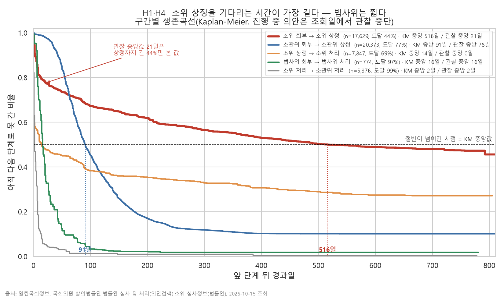
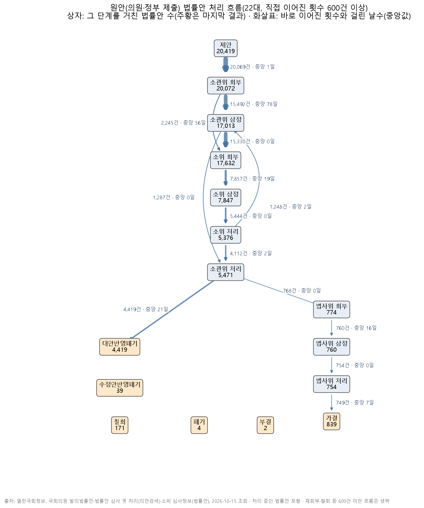
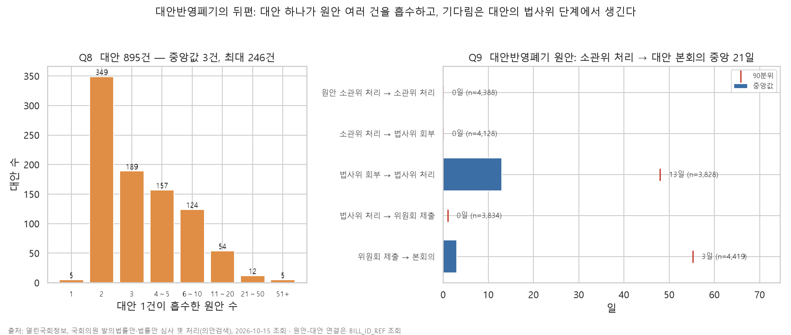

# 22대 국회 법률안은 어디서 멈추나: 프로세스 마이닝 보고서

**한 줄 요약**: 처리가 끝난 법률안만 보면 소위원회에서 심사가 시작되기까지 21일이면 될 것처럼 보인다. 하지만 아직 기다리고 있는 법률안까지 넣어 계산하면 **516일**이 걸리고, 이 구간이 처리 과정에서 가장 오래 멈추는 곳이다.

> **읽기 전에** 법률안은 맡은 위원회(**소관위**)로 넘어간 뒤, 그 안의 작은 모임(**소위**)에서 조문별로 심사를 받는다. **회부**는 심사를 맡기는 것, **상정**은 회의 안건으로 올려 실제로 다루기 시작하는 것이다. 위원회는 비슷한 법률안 여러 건을 합쳐 새 안(**대안**)을 만들기도 하는데, 이때 원래 법률안은 내용이 대안에 반영된 채 폐기된다(**대안반영폐기**). 그 밖의 용어는 [용어 정리](../docs/용어.md)에 있다.

## 데이터와 방법

| 항목 | 내용 |
|---|---|
| 대상 | 22대 국회 법률안 **21,326건**(제안일 2024-05-30～2026-10-14). 의원·정부가 낸 법률안 20,419건(의원 19,917 · 정부 502), 위원회가 낸 법률안 907건(대안 895 · 위원회안 12) |
| 이벤트 로그 | 법률안마다 "어떤 단계를 언제 거쳤는지"를 한 줄씩 펼친 표. 단계 18가지, 107,808줄. 아직 처리 중인 법률안(14,956건, 70%)도 넣었다 |
| 대안 연결 | 대안 1건이 어떤 법률안들을 흡수했는지 목록 4,469건을 따로 모아 연결했다. 대안반영폐기된 법률안 4,419건 모두 연결됨 |
| 기다린 기간 계산 | **끝난 법률안 기준** 중앙값과, **아직 기다리는 법률안까지 포함한** 중앙값(생존분석, Kaplan-Meier)을 함께 냈다 |
| 검증 | 날짜 항목의 뜻을 의안정보시스템 화면 30건(22대 27건, 21대 3건)과 직접 대조했다. 핵심 수치 497개를 두 가지 방법(Python 분석 도구 pm4py·pandas, SQL 데이터베이스 DuckDB)으로 따로 계산해 모두 같은 값이 나왔다 |

## 결과 1. 끝난 법률안만 보면 병목을 놓친다

곡선은 "앞 단계 뒤 시간이 지나면서 아직 다음 단계로 못 간 비율"이다. 천천히 내려갈수록 오래 기다린다는 뜻이고, 곡선이 절반(0.5) 아래로 내려가는 날이 "기다리는 법률안까지 포함한 중앙값"이다.

| 구간(의원·정부 법률안) | 끝난 법률안 기준 | 기다리는 법률안까지 포함 | 지금 이 구간에서 기다리는 법률안 |
|---|---|---|---|
| 소관위 회부 → 소관위 상정 | 78일 | 91일 | 2,204건 |
| **소위 회부 → 소위 상정** | **21일** | **516일** | **9,864건** |
| 소위 상정 → 소위 처리 | 0일 | 14일 | 2,287건 |
| 법사위 회부 → 법사위 상정 | 16일 | 16일 | 9건 |

- 소위에 넘어간 법률안 17,629건 중 실제로 소위 안건에 오른 것은 44%뿐이다. "21일"은 이 44%만 보고 낸 값이다. 아직 줄을 서 있는 사람을 빼고 대기시간을 재면 짧게 나오는 것과 같다
- 아직 처리 중인 법률안의 66%(9,864건)가 이 구간에서 기다리고 있다. 반면 법제사법위원회(법사위)의 법률 문구 검토 단계는 16일로 병목이 아니다
- 위원회끼리 비교해도 같은 일이 생긴다. 끝난 법률안 기준으로 가장 빠른 두 위원회(6일)는 기다리는 법률안까지 넣으면 295일, 569일이었다. 끝난 것만 보면 순서가 뒤집힌다
- 정부가 낸 법률안은 의원이 낸 법률안보다 소위 안건에 빨리 오른다(기다리는 법률안까지 포함한 중앙값 202일 대 531일)
- **이 방법이 맞는지 21대로 확인했다**([그림](age21/fig12_truncation.png)). 임기가 끝난 21대를 같은 시점(개원 뒤 868일)까지의 기록만 있는 것처럼 잘라 계산하니, 끝난 법률안 기준은 21일로 정답(임기 끝까지 본 값 397일)의 5%였고, 기다리는 법률안까지 포함한 값은 559일로 훨씬 가까웠다. 다만 자르는 시점에 따라 정답의 71～147% 사이에서 흔들려, 516일은 방향은 맞지만 이 정도 폭(정답보다 29% 짧게～47% 길게)이 있는 추정값으로 읽어야 한다

## 결과 2. 처리된 법률안의 대부분은 위원회 대안으로 끝난다

- 처리가 끝난 의원·정부 법률안 5,474건 중 4,419건(81%)이 대안반영폐기로 끝났다. 그대로 또는 고쳐서 통과(가결)된 것은 839건이고, 그중 749건이 법사위 검토를 거쳤다
- 처리된 법률안이 지나온 경로는 63가지이고, 가장 흔한 10가지가 93.9%를 차지한다

## 결과 3. 법률안은 한 건씩이 아니라 묶음으로 처리된다

- 소관위에서 처리된 법률안의 99.7%는 같은 날 같은 위원회에서 다른 법률안과 함께 처리됐다. 법률안 하나가 처리될 때 보통 같은 회의에서 42건이 함께 처리됐다(중앙값)
- 대안 1건은 법률안을 보통 3건, 많게는 246건 흡수했다
- 대안반영폐기된 법률안이 위원회에서 처리된 날부터 대안이 본회의를 통과하기까지는 21일(중앙값)이 걸렸다. 그중 13일이 대안의 법사위 검토 단계다

## 결과 4. 표준 절차는 72.7%가 따르고, 벗어난 경우의 90%는 법이 허용한 예외다

- 국회법 표준 절차를 모델로 정하고 실제 경로를 맞춰 봤다(적합성 검사, [그림](figures/fig11_conformance.png)). 끝난 법률안의 72.7%가 표준 절차를 그대로 따랐다
- 벗어난 경우의 90.4%는 법이 허용한 예외였고, 그중 대부분은 전체회의를 거치지 않고 소위에 바로 넘기는 **소위 직접 회부**(끝난 법률안의 21.6%)였다
- 나머지(2.6%)는 대부분 소위 기록 일부가 빠진 패턴으로, 적합성 검사가 데이터 품질 점검에도 쓰인다

## 개선 방향 (업무 흐름 관리 관점)

1. **"소위 안건 상정까지 기다린 기간"을 관리 지표로**: 끝난 법률안의 처리 기간만 보면 짧게 나온다. 소위에 넘어간 뒤 아직 안건에 오르지 못한 법률안의 수와 기다린 기간을 함께 봐야 실제 병목이 드러난다
2. **처리 중인 건을 포함한 기간 지표**: 기간 지표는 끝난 건만으로 낸 값 대신, 기다리는 건까지 포함한 중앙값이나 "1년 넘게 기다리는 건수"처럼 정의한다. 기다리는 건까지 포함한 중앙값도 관찰 기간이 짧으면 흔들리므로(21대 실험), 값 하나보다 범위나 추세로 본다
3. **묶음 단위로 추적**: 위원회는 대안으로 여러 법률안을 묶어 처리한다. 법률안 한 건이 아니라 묶음(대안) 단위로 진행 상황을 보면 흐름을 더 정확히 볼 수 있다
4. **정상 경로를 여러 개로**: 소위 직접 회부처럼 법이 허용한 경로를 정상 경로에 함께 넣어야 이탈 경보가 실제 문제(기록 누락 등)에 집중된다

## 한계

- 날짜가 일 단위라 같은 날 거친 단계 사이의 기다림은 0일로 잡힌다
- 오래 기다리는 이유(법안 내용, 정치 일정, 위원회 운영 등)는 이 데이터로 설명하지 않는다. 이 보고서는 절차의 흐름과 시간만 다룬다
- 생존분석에서는 중간에 철회 등 다른 결과로 끝난 법률안을 "그 시점까지만 관찰한 것"으로 다뤘다
- 이벤트 로그는 단계마다 첫 날짜만 쓴다. 위원회 회의별 기록(다시 심사한 경우 등)은 반복 심사 분석에만 따로 썼고, 본회의 상정일, 정부이송·공포일은 넣지 않았다
- API는 소관위 회부를 마지막 한 번만 준다. 다른 위원회로 다시 회부된 법률안은 "제안 → 회부"가 실제보다 길게 잡힌다(30일 넘게 걸린 164건 중 54건). 이 구간의 중앙값(1일)은 바뀌지 않는다
- 21대 실험은 지금의 최종 기록을 날짜로 자른 것이라, 당시 시스템에 실제로 있던 기록과는 다를 수 있다

---
출처: 열린국회정보, 국회의원 발의법률안·법률안 심사 및 처리(의안검색)·소위 심사정보(법률안), 2026-10-15 조회. 화면 대조: 의안정보시스템(likms.assembly.go.kr)
